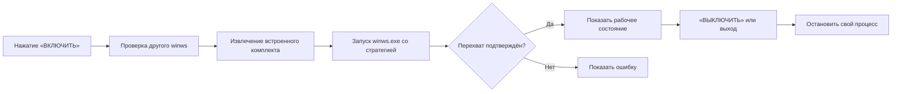

XR zapret

### Одна кнопка для запуска профиля YouTube и Discord


**🎮 YouTube и Discord · ⚡ Быстрый запуск · 🎨 Голубой интерфейс · 🧰 Диагностика**


</div>

XR zapret — приложение для Windows, которое запускает подготовленный профиль `winws` для YouTube и Discord. Нажмите **«ВКЛЮЧИТЬ»**, чтобы запустить движок, и **«ВЫКЛЮЧИТЬ»**, чтобы остановить процесс, запущенный приложением. Профиль и необходимые файлы встроены в EXE: отдельно открывать BAT-файлы не нужно.

> [!IMPORTANT]
> Успешный запуск движка подтверждает работу перехватчика, но не гарантирует доступ к сервисам в каждой сети. Результат зависит от способа блокировки и подключения.

## 🧭 Навигация

- [Возможности](#возможности)
- [Скриншоты](#скриншоты)
- [Быстрый старт](#быстрый-старт)
- [Требования](#требования)
- [Настройки](#настройки)
- [Как это устроено](#как-это-устроено)
- [Проверка работы](#проверка-работы)
- [Если что-то не работает](#если-что-то-не-работает)
- [Частые вопросы](#частые-вопросы)
- [Сборка из исходников](#сборка-из-исходников)
- [Авторы и лицензии](#авторы-и-лицензии)

## Возможности

| Стикер | Что есть в приложении |
|:--:|---|
| 🔘 | Одна кнопка включает и выключает подготовленный профиль. |
| 📦 | `winws.exe`, стратегия, списки адресов и остальные нужные файлы находятся внутри EXE. |
| 🧭 | Приложение показывает состояние движка прямо в главном окне. |
| 🎬 | При открытии проигрывается анимированная заставка с логотипом XR. |
| 🌙 | Интерфейс использует сине-голубую тему и иллюстрированный фон. |
| ⚙️ | Настройки открываются шестерёнкой в **левом верхнем углу**. |
| 🖥️ | Окно можно сворачивать в системный трей и управлять запуском оттуда. |
| 📋 | Кнопка диагностики копирует состояние и последнее сообщение движка. |

Анимация интерфейса рассчитана на **80 кадров/с**. Фактическая плавность зависит от компьютера и нагрузки Windows.

## Скриншоты

<table>
  <tr><td align="center"><b>Главное окно</b></td><td align="center"><b>Настройки</b></td></tr>
  <tr>
    <td></td>
    <td></td>
  </tr>
</table>

<details>
<summary><b>🎞️ Показать заставку запуска</b></summary>

<br>


</details>

## Быстрый старт

1. Скачайте [**`XR zapret.exe`**](dist/XR%20zapret.exe) из этого репозитория или из раздела Releases, когда релиз будет опубликован.
2. Запустите EXE на 64-битной Windows. Если система попросит установить .NET Framework, поставьте [**.NET Framework 4.8 Runtime** с сайта Microsoft](https://dotnet.microsoft.com/en-us/download/dotnet-framework/net48).
3. Нажмите **«ВКЛЮЧИТЬ»** и подтвердите стандартный запрос Windows на права администратора.
4. Дождитесь сообщения о запуске перехвата и проверьте YouTube и Discord в своей сети.
5. Чтобы остановить профиль, нажмите **«ВЫКЛЮЧИТЬ»**. Если включено сворачивание в трей, эту же команду можно выбрать в меню значка приложения.

> [!TIP]
> Папку `Payload` и BAT-файлы переносить вместе с готовым EXE не требуется. При первом включении встроенные файлы извлекаются автоматически.

## Требования

| Компонент | Требование |
|---|---|
| Операционная система | 64-битная Windows. |
| Среда выполнения | .NET Framework 4.8 Runtime. На многих компьютерах она уже установлена. |
| Права | Для запуска сетевого движка нужно подтвердить запрос администратора. |
| Интернет | Нужен для проверки YouTube/Discord и для скачивания .NET, если он отсутствует. |

**Устанавливать Windows заново не нужно**, если на компьютере уже работает подходящая 64-битная версия. Для запуска приложения достаточно **Runtime**; пакет **Developer Pack** пользователю не нужен.

## Настройки

Нажмите на **шестерёнку слева вверху**. Изменения сохраняются автоматически.

| Настройка | Поведение |
|---|---|
| **Включать при открытии** | При следующем запуске приложения профиль включится после заставки. Windows может снова запросить права администратора. Эта настройка **не добавляет** приложение в автозагрузку Windows. |
| **Оставлять в трее** | Нажатие на крестик скрывает окно, а запущенный движок продолжает работать. Значок в трее позволяет открыть окно, остановить профиль или полностью выйти. |
| **Копировать диагностику** | Копирует в буфер обмена состояние движка, последнее сообщение и значения настроек. Удобно приложить к сообщению об ошибке. |

Когда режим трея выключен, закрытие окна завершает приложение и останавливает процесс `winws.exe`, который оно запустило. При включённом режиме трея для полного выхода выберите **«Выход»** в меню значка.

Настройки хранятся в:

```text
%LOCALAPPDATA%\XRzapret\settings.ini
```

## Как это устроено



- Приложение запускает `winws.exe` напрямую с профилем `spark-strategy.txt`; сценарии `general*.bat` и `service.bat` при этом не выполняются.
- При первом включении встроенный комплект извлекается в `%LOCALAPPDATA%\XRzapret\payload-<hash>`.
- Рабочее состояние появляется после сообщения движка `windivert initialized. capture is started.`. Если подтверждение не пришло или процесс завершился, приложение показывает ошибку.
- При обнаружении другого запущенного `winws.exe` XR zapret просит остановить его вручную. Чужой процесс приложение не завершает.
- Кнопка выключения и обычное закрытие приложения останавливают только тот процесс `winws.exe`, который запустил XR zapret.

Профиль направлен на YouTube и Discord. В комплекте есть списки адресов и параметры обработки TCP/UDP-трафика. Возможность открыть конкретный сайт или использовать голосовой канал нужно проверять в той сети, где возникла блокировка.

## Проверка работы

1. Откройте приложение и включите профиль.
2. Убедитесь, что XR zapret показывает подтверждённый запуск движка.
3. Откройте YouTube в браузере, затем проверьте Discord. Для Discord отдельно проверьте голосовой канал, если именно он важен.
4. Если проблема сохранилась, нажмите **«КОПИРОВАТЬ ДИАГНОСТИКУ»** в настройках и запишите, что именно не открылось: сайт, видео, вход в Discord или голосовой канал.

Сообщение о запуске перехвата означает, что движок стартовал. Оно само по себе не является проверкой доступности YouTube или Discord.

## Если что-то не работает

| Ситуация | Что сделать |
|---|---|
| Windows просит .NET Framework | Установить [официальный .NET Framework 4.8 Runtime](https://dotnet.microsoft.com/en-us/download/dotnet-framework/net48), затем повторить запуск. |
| Windows запрашивает права администратора | Подтвердить запрос, если EXE получен из доверенного источника. Эти права нужны для сетевого движка. |
| Приложение сообщает о другом `winws.exe` | Остановить уже работающий профиль в его программе и снова нажать «ВКЛЮЧИТЬ». |
| Движок не подтвердил запуск | Открыть настройки → «КОПИРОВАТЬ ДИАГНОСТИКУ». Проверить сообщение об ошибке. |
| Движок работает, но YouTube или Discord не открывается | Записать конкретный адрес/действие и тип подключения. Стратегия может не подходить для этой сети. |
| После крестика окно исчезло, а профиль работает | Включён режим трея. Найти значок XR zapret возле часов; через его меню открыть окно или выйти. |
| Нужно полностью остановить работу | Нажать «ВЫКЛЮЧИТЬ», затем закрыть окно или выбрать «Выход» в трее. |

При сообщении об ошибке полезно приложить диагностику и указать версию Windows, тип подключения, что именно проверялось и на каком шаге появилась проблема. Не публикуйте в открытом Issue личные данные, если они попали в текст сообщения.

## Частые вопросы

<details>
<summary><b>Нужно ли запускать один из BAT-файлов?</b></summary>

Нет. Готовый EXE включает необходимый комплект и запускает профиль напрямую.

</details>

<details>
<summary><b>«Включать при открытии» — это автозагрузка вместе с Windows?</b></summary>

Нет. Профиль включается только после того, как вы сами открыли XR zapret.

</details>

<details>
<summary><b>Будет ли профиль работать после закрытия окна?</b></summary>

Если включено «Оставлять в трее», крестик скрывает окно и профиль продолжает работать. Для полного выхода откройте меню значка в трее. Если настройка выключена, закрытие окна останавливает процесс, запущенный приложением.

</details>

<details>
<summary><b>Можно ли использовать XR zapret вместе с другим запущенным winws?</b></summary>

Приложение обнаруживает другой `winws.exe` и не запускает второй экземпляр профиля. Остановите предыдущий процесс в той программе, которая его запустила.

</details>

<details>
<summary><b>Почему нет гарантии работы в моей сети?</b></summary>

Разные сети применяют разные методы ограничения трафика. Текущий профиль может работать в одной сети и требовать настройки в другой. Проверяйте результат на своём подключении.

</details>

<details>
<summary><b>Где приложение хранит файлы?</b></summary>

Настройки и извлечённый комплект находятся в `%LOCALAPPDATA%\XRzapret`. Папка с исходниками и `Payload` нужна разработчику для пересборки, но не обычному пользователю EXE.

</details>

## Сборка из исходников

Для сборки нужны Windows, PowerShell и установленный .NET Framework 4.x с доступным компилятором C#. В корне проекта выполните:

```powershell
.\build.ps1
```

Готовый файл появится по пути:

```text
dist\XR zapret.exe
```

Скрипт собирает архив из папки `Payload`, встраивает его вместе с фоном и иконкой в EXE и выводит SHA-256 собранного файла. Сборка не выполняется из одного только `Program.cs`: для неё нужны остальные файлы проекта и исходный комплект `Payload`.

### Структура проекта

```text
BatLauncher/
├─ Program.cs                 # окно, анимация, кнопки и трей
├─ WinwsController.cs         # запуск и остановка движка
├─ AppSettings.cs             # сохранение настроек
├─ build.ps1                  # сборка Windows-приложения
├─ Assets/background.jpg      # фон окна
├─ app.ico                    # иконка EXE
├─ app-preview.png            # логотип для README
├─ Payload/                   # встроенный комплект и стратегия
│  ├─ spark-strategy.txt
│  ├─ bin/
│  ├─ lists/
│  └─ LICENSE.txt
└─ dist/XR zapret.exe         # результат сборки
```

## Авторы и лицензии

XR zapret предоставляет интерфейс и подготовленный профиль для существующего движка. Сетевые компоненты взяты из следующих проектов:

- [zapret — bol-van](https://github.com/bol-van/zapret) — исходный проект `winws`.
- [zapret-discord-youtube — Flowseal](https://github.com/Flowseal/zapret-discord-youtube) — комплект для YouTube и Discord, на основе которого подготовлен встроенный набор файлов.
- [WinDivert — basil00](https://github.com/basil00/WinDivert) — компонент перехвата сетевого трафика; его собственные условия лицензирования приведены в исходном комплекте.

Уведомления об авторских правах и условия сторонних компонентов сохранены в [`Payload/LICENSE.txt`](Payload/LICENSE.txt) и файлах исходного комплекта. Перед распространением изменённой сборки проверьте условия лицензий всех включённых компонентов. Отдельная лицензия на код интерфейса XR zapret в этом репозитории пока не объявлена.

---

<div align="center">

**💠 XR zapret · 🎮 YouTube + Discord · 🔘 Одна кнопка**

</div>
